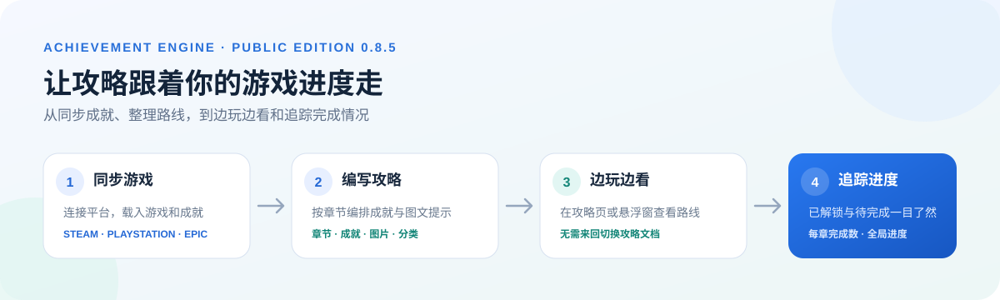
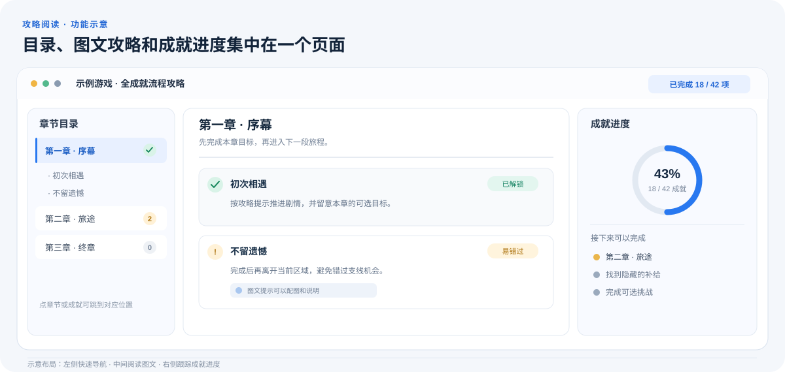
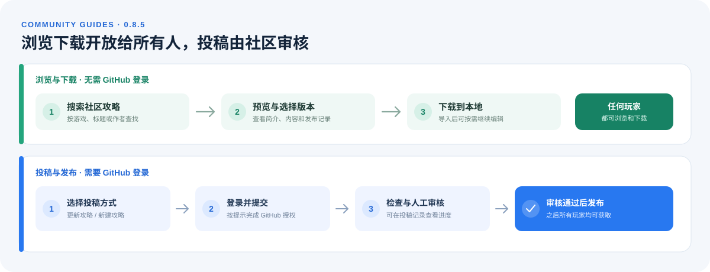
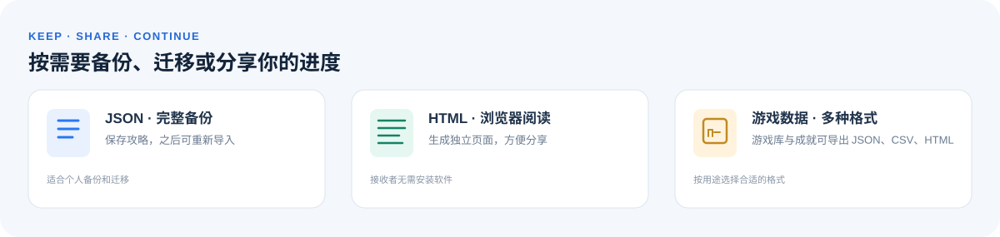

# 🎮 Achievement Engine

**全成就与奖杯攻略工具 · Windows 桌面版**

把游戏进度、攻略路线和成就完成情况放在一起

[下载最新版](https://github.com/dxydjl0521-maker/achievement-engine-releases/releases/latest) · [快速开始](#快速开始) · [社区攻略](#社区攻略)

> 本说明适用于公开版 **v0.8.5**。图片为功能示意图，用来说明页面和操作流程。

## 你可以用它做什么

- 查看 Steam、PlayStation 和 Epic 游戏的成就或奖杯进度。
- 按章节编写图文攻略，把游戏成就、完成情况和自己的提示放在一起。
- 游玩时打开攻略悬浮窗，查看接下来要做的内容。
- 在社区浏览和下载其他玩家已发布的攻略，也可以提交新攻略或改进现有攻略。
- 导出攻略备份，或生成可以用浏览器打开的 HTML 版本。

## 下载与安装

系统要求：**Windows 10 或 Windows 11，64 位**。

前往[最新版本下载页](https://github.com/dxydjl0521-maker/achievement-engine-releases/releases/latest)，下载名称类似 `Achievement Engine Setup 0.8.5.exe` 的安装程序，双击后按提示完成安装。该安装包用于公开版。

## 快速开始

### 1. 连接游戏平台

- **Steam**：先在 [Steam Web API Key 页面](https://steamcommunity.com/dev/apikey)申请 Key，再按软件首次启动指引填写，并使用 SteamID64 或个人资料链接登录。Steam 个人资料中的“游戏详情”需要设为公开，软件才能读取成就资料。
- **PlayStation**：在登录页或账号设置中按提示完成 PSN 授权。授权信息应像密码一样妥善保管；授权失效时，可按软件提示重新连接。
- **Epic**：先安装并登录 [Legendary](https://github.com/derrod/legendary)，再按软件提示选择并同步游戏。Epic 的部分游戏可能没有可读取的成就。

连接后可在游戏库中切换平台，查看对应游戏。不同平台的同名游戏会分别显示。

### 2. 同步游戏和成就

先同步游戏库，再同步成就资料。游戏详情页可以查看成就名称、说明、解锁状态和进度；需要更新时，可以手动重新同步。Steam 游戏还可以开启自动同步。

Steam 成就文本的显示语言可以在设置中选择，单个游戏也可以单独设置。已有的用户译文、社区译文和平台原文可按需切换；缺少译文时，可以查找社区翻译或导入自己整理的译文。界面语言与成就文本语言是分开的。

界面语言可在“设置”中切换中文或 English；也可以按喜好选择深色或浅色主题，以及霓虹或简约风格。

### 3. 编写和阅读攻略

在游戏详情页打开攻略，新建或选择一份攻略。你可以按章节安排流程，为成就添加分类、备注和图文说明，并拖动调整顺序。阅读时，章节完成数和成就解锁状态会跟随你的游戏进度更新。

同一款游戏可以保存多份独立攻略，例如流程攻略、收集攻略或不同难度的攻略。

攻略悬浮窗可以单独显示在游戏画面旁，方便边玩边看；悬浮编辑窗适合在游玩过程中补充已有条目的文字和图片。可在“设置 → 快捷键”中查看或修改快捷键。

## 社区攻略

在软件的“社区攻略”页面可以搜索、预览和下载已发布攻略。**浏览和下载不需要登录 GitHub。**

投稿需要使用 GitHub 账号登录。选择投稿方式时：

- **更新攻略**：从社区下载攻略并编辑后，选择它来提交改进。审核通过并发布后，会成为该攻略系列的新版本。
- **新建攻略**：选择本地新建的攻略，创建独立的社区攻略系列。同一款游戏可以有多份结构或思路不同的攻略。

投稿后可在“投稿记录”中查看审核进度。提交不等于立即发布；审核并正式发布后，其他玩家才能浏览和下载。

首次投稿时，软件会引导你到 GitHub 完成授权。请在 GitHub 页面确认账号和授权范围；不投稿时无需登录。

## 备份与分享

- **攻略 JSON**：保存完整攻略，适合备份或在 Achievement Engine 中重新导入。
- **攻略 HTML**：生成可由浏览器打开的攻略页面，方便分享和阅读。
- **游戏库与成就数据**：可导出为 JSON、CSV 或 HTML。

建议定期导出攻略备份。含图片的攻略文件可能较大。

## 常见问题

**游戏或成就没有显示？**

确认对应平台已经连接并完成同步。Steam 用户还需确认个人资料的“游戏详情”公开，并检查 Steam Web API Key 是否有效。

**为什么某些 Epic 游戏没有成就？**

Epic 并未为所有游戏提供可读取的成就资料；这类游戏仍可能显示在游戏库中，但没有可同步的成就。

**提交的社区攻略为什么暂时搜不到？**

社区投稿需要完成检查和维护者审核。发布前只会显示在投稿记录中，不会进入公开攻略目录。

**在哪里反馈问题？**

请在本仓库的 [Issues](https://github.com/dxydjl0521-maker/achievement-engine-releases/issues) 页面描述问题，并附上软件版本及相关页面截图。请不要公开 Steam API Key、PSN 授权信息或其他账号凭据。

## 许可与说明

软件由作者保留所有权利。社区攻略的许可和使用条件以每份攻略注明的信息为准。Steam、PlayStation 和 Epic 相关名称及商标归各自权利人所有；Achievement Engine 与这些平台无官方关联。
